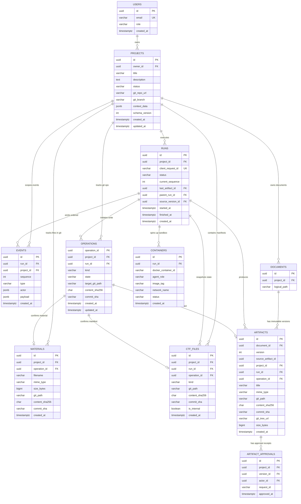

# ADR-001: Каноническая модель хранения сущности Project на базе PostgreSQL и Git-репозитория, контейнеризация агентов и жизненный цикл данных

- **Статус:** Proposed — правки на ревью 2026-10-16 (Арина / Дмитрий / Илья), не Accepted
- **Основание правок:** Катя подтвердила сохранение через gateway и ответы WEB 16–21. Это подтверждение направления со стороны владельца WEB, не согласование реализации всеми сервисами.
- **Канонический event contract:** [events.v0, runner f9dca8e](https://github.com/AcryCxde/PP-Sber-Autumn-2026/blob/f9dca8e57e778543a29d98ef704e466ab8fb3776/docs/contracts/events-v0.md); ADR уточняет хранение, а не вводит конкурирующую ленту.
- **Дата:** 2026-10-15
- **Контекст:** Эпик 2.5 (пакет закрытия v3), задача PPS-141 (S2 Storage ADR), интеграция с направлениями 2.1, 2.3 и спецификациями `2.5-1`, `2.5-2`, `2.5-3`, `2.5-4`, `2.5-8`, `2.5-9`, контракт `events v0` (#8)
- **Целевой артефакт:** `docs/adr/ADR-001-storage.md`
- **Ветка интеграции:** `PPS-2/web-demo/epic-2.5-v3`
- **Зависимости:** Gateway, Runner, Auth/ownership (`2.5-1`, `2.5-4`), Events Contract v0 (`#8`)

---

## 1. Контекст и проблематика

В рамках разработки серверного контура платформы CoreTeam необходимо зафиксировать каноническую модель хранения сущности `Project` и связанных с ней подсущностей.

По прямому требованию заказчика для долговременного хранения сгенерированных отчетов, результатов аналитической работы (Markdown-артефактов) и сопутствующих манифестов вместо внешнего объектного S3-хранилища должен использоваться **Git-репозиторий**.

### Архитектурные требования и ограничения:
1. **Git-as-Storage для результатов:** Итоговые подтвержденные артефакты (`text/markdown`) и служебные конфигурации фреймворка сохраняются коммитами в целевой Git-репозиторий проекта.
2. **Версионирование и идемпотентность записи:** Каждая подтвержденная версия артефакта строго фиксируется уникальным `commit_sha`, ключом идемпотентности операции `operation_id` и контрольной суммой содержимого `content_sha256` по протоколу «намерение → коммит → подтверждение».
3. **Идемпотентность и сериализация запусков:** Повторная отправка запроса на старт с тем же `client_request_id` не создает дублирующий запуск, а на уровне БД действует жесткое ограничение версии v1 — не более одного активного запуска на проект.
4. **Разделение контуров безопасности:** Внутренние рассуждения моделей (Chain-of-Thought), промежуточные токены, shell-команды, системные логи и секреты не попадают в Git и не передаются в публичные события платформы (`2.5-3`, `2.5-8`).
5. **Консистентность статусов (Confirmed Write):** Статус `completed` выставляется в БД только после подтвержденного `git commit` / `git push`, перевода записи в `operations` в состояние `confirmed` и фиксации публичного события `artifact.saved` (`2.5-2`, `2.5-3`, `events v0`).
6. **Метаданные и события в PostgreSQL:** Метаданные проектов, права доступа, сессии пользователей, операции записи и строгий упорядоченный журнал публичных событий хранятся в реляционной СУБД.
7. **Контейнерная изоляция исполнителей:** Мультиагентная команда CoreTeam развертывается в изолированной песочнице на Runner-ноде без прямого внешнего сетевого доступа к промежуточным файлам, дебатам и отладке.

---

## 2. Архитектурное решение (Decision)

Предлагается гибридная архитектура **PostgreSQL + Git-as-Storage**. Единственная точка долговременной записи — **gateway через адаптер хранения 2.3**: он ведёт `operations`, метаданные и публичную ленту, проверяет сохранённые bytes и подтверждает `artifact.saved`. Runner исполняет задачу и создаёт локальный checkpoint, но не пишет напрямую в PostgreSQL или центральный Git-as-Storage.

Локальный Git/checkpoint runner и центральное хранилище результатов — разные контуры. Передача bytes между ними ещё требует согласованного механизма; `artifact.created` само по себе не передаёт файл и не доказывает сохранение.

Компоненты:
- **PostgreSQL 16:** хранит профили пользователей, сессии, метаданные проектов, статусы запусков (`runs`), журнал идемпотентных операций записи (`operations`) и журнал публичных событий (`events`).
- **Git-репозиторий:** выступает неизменяемым версионированным хранилищем входных материалов (`materials`), готовых отчетов (`artifacts`) и системных манифестов (`ctf_files`).
- **Runner Sandbox (Docker + Redis In-Memory):** изолированная среда исполнения на узле CoreTeam Runner, объединяющая контейнеры агентов в приватную сеть с шиной взаимодействия в оперативной памяти и общим временным рабочим диском.

### 2.1. Топология системы и компонентное взаимодействие

```mermaid
flowchart TB
    subgraph ClientLayer["Клиентский контур (Frontend: Web UI)"]
        UI["Web UI Dashboard\n(Профиль, Запуск, Мониторинг)"]
    end

    subgraph ControlPlane["Контур управления платформой (Control Plane)"]
        GW["API Gateway / Backend"]
        AUTH["Auth & Ownership Service\n(Better Auth / 2.5-1, 2.5-4)"]
        PG[("PostgreSQL 16\n(users, projects, runs, operations,\nevents, artifacts, materials, ctf_files)")]
    end

    subgraph ExecutionPlane["Изолированный контур исполнения (Runner Node)"]
        RUNNER["CoreTeam Runner\n(Execution & Local Checkpoint)"]
        
        subgraph AgentSandbox["Песочница запуска (Run Sandbox: run_id)"]
            NET["Изолированная сеть (Bridge: net-{run_id})"]
            REDIS[("Redis In-Memory\n(Scratchpad / CoT / PubSub Bus)")]
            VOL[("Ephemeral Volume\n(mount: /workspace)")]
            
            A_COORD["Агент-Фасилитатор\n(Coordinator Container)"]
            A_DS["Агент Data Analyst\n(Worker Container)"]
            A_ML["Агент ML Specialist\n(Worker Container)"]
            A_REV["Агент Рецензент\n(Reviewer Container)"]
        end
    end

    subgraph StoragePlane["Версионированное хранилище результатов (Storage Plane)"]
        GIT[("Git-as-Storage\nprojects/{id}/materials/\nprojects/{id}/runs/{id}/result.md\nprojects/{id}/.ctf/*.json")]
    end

    UI <-->|"HTTPS / WSS (События events v0 / 2.5-3)"| GW
    GW <-->|"Проверка владения (owner_id) и сессий"| AUTH
    GW <-->|"CRUD метаданных, Operations и Event Log"| PG

    GW -->|"Task Dispatch (run_id, client_request_id, branch)"| RUNNER
    RUNNER -->|"Dynamic Sandbox Spin-up"| AgentSandbox

    A_COORD <-->|"Pub/Sub диалог & Scratchpad (CoT)"| REDIS
    A_DS <-->|"Pub/Sub диалог & Scratchpad (CoT)"| REDIS
    A_ML <-->|"Pub/Sub диалог & Scratchpad (CoT)"| REDIS
    A_REV <-->|"Pub/Sub диалог & Scratchpad (CoT)"| REDIS

    A_COORD & A_DS & A_ML & A_REV <-->|"Скрипты и расчетные таблицы"| VOL

    A_COORD -->|"Санированный прогресс (progress.updated)"| RUNNER
    RUNNER -->|"Публичные события (INSERT events)"| GW
    
    RUNNER -->|"artifact.created + передача bytes (канал на ревью)"| GW
    GW -->|"Через адаптер 2.3: Intent -> Commit & Push -> Confirm"| GIT
    GW -.->|"Чтение подтверждённых снимков по commit_sha"| GIT
```



### 2.2. Контейнеризация и межагентное взаимодействие

**Граница текущей интеграции:** описанный ниже per-Run Docker/Redis-стек — отдельное будущее предложение, не факт реализации и не условие подключения хранения. Текущий runner использует контейнер проекта, постоянный том, журнал и checkpoint. Не уничтожать их при завершении Run или сбое. Детали будущей топологии требуют отдельного решения Ильи.

#### Развертывание и жизненный цикл контейнеров
1. **Среда выполнения (Runner Node):**
   - Все контейнеры агентов развертываются локально на узле выполнения **CoreTeam Runner**.
   - Runner динамически инициализирует легковесный контейнерный стек под каждый конкретный запуск (`run_id`).
   - Контейнеры запускаются с жесткими ограничениями по ресурсам (cgroups: лимиты CPU и RAM) и read-only системным корнем.
   - В будущем стеке очищаются только временные ресурсы. Постоянный том проекта, журнал восстановления и bytes неподтверждённых операций сохраняются; teardown не является подтверждением записи.

#### Межагентный транспорт и разделение контуров памяти
- **Виртуальная изоляция (`Bridge Network`):** Локальная подсеть `net-{run_id}` замыкает сетевой обмен строго внутри песочницы. Прямой доступ из внешней сети в контейнеры заблокирован.
- **Шина обмена сообщениями (Redis In-Memory):**
  - **Диалоговый канал (Pub/Sub):** Агенты координируют распределение задач и передачу промежуточных результатов через каналы Redis (`channel:coordination`, `channel:tasks`).
  - **Scratchpad (Рабочая память цепочки рассуждений):** Промежуточные рассуждения моделей (CoT), сырые вызовы инструментов и внутренние гипотезы сохраняются в оперативной памяти Redis со сроком жизни, равным времени выполнения запуска (TTL = Run Duration).
  - **Политика безопасности (`2.5-3`):** Данные из Scratchpad **никогда не покидают песочницу**, не записываются в PostgreSQL и не попадают в Git. Вся память Redis сбрасывается и освобождается при Teardown песочницы.
- **Общий рабочий том (`Ephemeral Volume: /workspace`):**
  - Монтируется в контейнеры текущего запуска.
  - Позволяет агентам обмениваться промежуточными файлами (скриптами анализа, сырыми выгрузками таблиц, промежуточными вычислениями).
  - Очистка временных файлов допустима только после durable-подтверждения gateway; постоянный том проекта и recovery-журнал не удаляются.

### 2.3. Структура каталогов в Git-репозитории

Каждый проект и запуск изолированы в структуре директорий репозитория:

```text
repo-root/
└── projects/
    └── {project_id}/
        ├── materials/              # Входные файлы пользователя (2.5-8: PDF, DOCX, TXT, MD, PNG, JPG)
        │   └── dataset_spec.pdf
        ├── .ctf/                   # Служебные файлы фреймворка (манифесты, роли)
        │   ├── team_manifest.json
        │   └── framework_state.json
        └── runs/
            └── {run_id}/
                └── result.md       # Итоговый подтвержденный артефакт (Markdown)
```

### 2.4. Реляционная модель данных (PostgreSQL)

Диаграмма — предлагаемая модель; это не выполненная миграция. Базовые поля описаны в §2.5, дополнения документа/версии/одобрения — в §2.8. Требуется сверка с фактической БД gateway.



### 2.5. Спецификация таблиц PostgreSQL и DDL-ограничений

#### 1. Проекты (`projects`)
- `id` (`UUID`, Primary Key)
- `owner_id` (`UUID`, Foreign Key $\rightarrow$ `users.id`, `NOT NULL`) — идентификатор единственного владельца проекта (`2.5-1`)
- `title` (`VARCHAR(255)`, `NOT NULL`) — название проекта
- `description` (`TEXT`) — описание проекта
- `status` (`VARCHAR(32)`, `NOT NULL`) — статус: `draft` | `team_proposed` | `active` | `archived`
- `git_repo_url` (`VARCHAR(512)`, `NOT NULL`) — ссылка на рабочий Git-репозиторий проекта
- `git_branch` (`VARCHAR(128)`, default: `'main'`) — основная ветка проекта
- `context_data` (`JSONB`, default: `'{}'`) — цели проекта, входные требования, история ответов фасилитатору
- `schema_version` (`INT`, default: `1`, `NOT NULL`) — версия для оптимистической блокировки (Optimistic Concurrency Control)
- `created_at`, `updated_at` (`TIMESTAMPTZ`, `NOT NULL`)

#### 2. Входные материалы (`materials`)
- `id` (`UUID`, Primary Key)
- `project_id` (`UUID`, Foreign Key $\rightarrow$ `projects.id`, `NOT NULL`)
- `operation_id` (`UUID`, Foreign Key $\rightarrow$ `operations.operation_id`, `UNIQUE`, `NOT NULL`) — привязка к операции записи в Git
- `filename` (`VARCHAR(255)`, `NOT NULL`) — оригинальное имя файла
- `mime_type` (`VARCHAR(128)`, `NOT NULL`) — поддерживаемые типы (`2.5-8`: PDF, DOCX, TXT, MD, PNG, JPG)
- `size_bytes` (`BIGINT`, `NOT NULL`) — размер файла в байтах
- `git_path` (`VARCHAR(512)`, `NOT NULL`) — путь внутри репозитория (`projects/{project_id}/materials/...`)
- `content_sha256` (`CHAR(64)`, `NOT NULL`) — SHA-256 хеш содержимого файла для сверки идемпотентности
- `commit_sha` (`VARCHAR(40)`, `NOT NULL`) — хеш коммита фиксации материала в Git
- `created_at` (`TIMESTAMPTZ`, `NOT NULL`)

#### 3. Запуски пайплайна (`runs`)
- `id` (`UUID`, Primary Key)
- `project_id` (`UUID`, Foreign Key $\rightarrow$ `projects.id`, `NOT NULL`)
- `client_request_id` (`VARCHAR(128)`, `UNIQUE`, `NOT NULL`) — ключ идемпотентности клиентского запроса на запуск (контракт 2.1 и `events v0` #8). Защищает от создания дублей при повторном нажатии кнопки «Запустить» или сетевых ретраях.
- `status` (`VARCHAR(32)`, `NOT NULL`) — единый канонический статус жизненного цикла по словарю спецификации `2.5-2`:
  - `queued` | `running` | `waiting_for_input` | `completed` | `failed` | `outcome_unknown`
  - `completed`, `failed`, `outcome_unknown` — терминальные. `partial`/review — свойства результата, не новый статус исполнения. Старые значения мигрируются явно, история не удаляется; отмена/лимиты не добавляются в v0 без отдельного изменения контракта.
- `current_sequence` (`INT`, default: `0`, `NOT NULL`) — монотонный счетчик для упорядочивания событий запуска
- `last_artifact_id` (`UUID`, Foreign Key $\rightarrow$ `artifacts.id`, nullable) — ссылка на последний подтвержденный артефакт
- `started_at`, `finished_at`, `created_at` (`TIMESTAMPTZ`)
- **Ограничения и индексы (`runs`):**
  ```sql
  -- 1. Идемпотентность старта по ключу запроса клиента:
  ALTER TABLE runs ADD CONSTRAINT uq_runs_client_request_id UNIQUE (client_request_id);

  -- 2. Ограничение v1 «один активный запуск на проект» (защита от параллельных запусков с разных вкладок):
  CREATE UNIQUE INDEX idx_runs_one_active_per_project
      ON runs (project_id)
      WHERE status IN ('queued', 'running', 'waiting_for_input');
  ```

#### 4. Журнал идемпотентных операций записи в Git (`operations`)
Журнал gateway/адаптера 2.3 для протокола «намерение → коммит → подтверждение». Сверка разрешает исход операции записи, **не переоткрывает терминальный Run** (§5.2):
- `operation_id` (`UUID`, Primary Key) — уникальный ключ идемпотентности операции записи
- `project_id` (`UUID`, Foreign Key $\rightarrow$ `projects.id`, `NOT NULL`)
- `run_id` (`UUID`, Foreign Key $\rightarrow$ `runs.id`, nullable — заполняется для записей артефактов и манифестов запуска)
- `kind` (`VARCHAR(32)`, `NOT NULL`): `artifact_write` | `material_upload` | `ctf_sync`
- `state` (`VARCHAR(32)`, `NOT NULL`): `intent` | `committed` | `confirmed` | `failed`
- `target_git_path` (`VARCHAR(512)`, `NOT NULL`) — целевой путь файла в репозитории
- `content_sha256` (`CHAR(64)`, `NOT NULL`) — предвычисленный SHA-256 хеш полезной нагрузки до отправки в Git
- `commit_sha` (`VARCHAR(40)`, nullable) — заполняется после получения подтверждения от Git
- `created_at`, `updated_at` (`TIMESTAMPTZ`, `NOT NULL`)
- **Ограничения и индексы (`operations`):**
  ```sql
  -- Гарантия отсутствия дублирующих операций записи одного типа в рамках запуска и пути:
  CREATE UNIQUE INDEX uq_operations_run_path_hash
      ON operations (run_id, target_git_path, content_sha256)
      WHERE run_id IS NOT NULL;
  ```

#### 5. Публичные события (`events`)
- `id` (`UUID`, Primary Key)
- `run_id` (`UUID`, Foreign Key $\rightarrow$ `runs.id`, `NOT NULL`)
- `project_id` (`UUID`, Foreign Key $\rightarrow$ `projects.id`, `NOT NULL`)
- `sequence` (`INT`, `NOT NULL`) — строгий порядковый номер внутри запуска
- `type` (`VARCHAR(64)`, `NOT NULL`) — канонический публичный тип события по словарю контракта `events v0` (#8) и `2.5-3`:
  - `run.accepted` | `run.started` | `role.started` | `role.completed` | `message.created` | `facilitator.question` | `user.answer.accepted` | `progress.updated` | `artifact.created` | `artifact.saved` | `run.completed` | `run.failed` | `run.outcome_unknown`
  - `id` сохраняет исходный стабильный `event_id`; gateway дедуплицирует по нему до назначения `sequence`/wire `seq`. Повтор не расходует номер. События записываются до публикации, терминальное — одно и последнее.
  - `usage.reported` и optional hash/size уже описаны в [исходной ветке runner 8bfe889](https://github.com/AcryCxde/PP-Sber-Autumn-2026/blob/8bfe889928c8b2755eb3545eee4758162e7bde0e/docs/contracts/events-v0.md). Они не входят в старый закреплённый здесь базовый словарь f9dca8e: при интеграции согласовать существующее расширение и общий SHA, не отбрасывать usage и не создавать вторую схему.
- `actor` (`JSONB`, nullable) — публичная роль CoreTeam (`{"roleId": "data_analyst", "displayName": "Аналитик данных"}`)
- `payload` (`JSONB`, `NOT NULL`) — нормализованные безопасные данные шага (прогресс, текст, вопрос фасилитатора)
- `created_at` (`TIMESTAMPTZ`, `NOT NULL`)
- **Ограничения и индексы (`events`):**
  ```sql
  -- Уникальность номера; отсутствие пропусков обеспечивает сериализованная запись, восстановление — replay:
  -- id = исходный event_id; PRIMARY KEY уже обеспечивает его уникальность.
  ALTER TABLE events ADD CONSTRAINT uq_events_run_sequence UNIQUE (run_id, sequence);
  ```

#### 6. Подтвержденные артефакты (`artifacts`)
- `id` (`UUID`, Primary Key) — immutable `version_id` хранилища, не `artifact_id` runner
- `document_id` (`UUID`, NOT NULL, FK → `documents.id`) — стабильный документ проекта (§2.8)
- `version` (`INT`, NOT NULL, CHECK > 0) — номер версии внутри документа
- `source_artifact_id` (`UUID`, NOT NULL) — исходный `artifact_id` runner; сохраняется отдельно
- `UNIQUE(document_id, version)`; повтор той же операции возвращает ту же версию, а не следующую
- `project_id` (`UUID`, Foreign Key $\rightarrow$ `projects.id`, `NOT NULL`)
- `run_id` (`UUID`, Foreign Key $\rightarrow$ `runs.id`, `NOT NULL`)
- `operation_id` (`UUID`, Foreign Key $\rightarrow$ `operations.operation_id`, `UNIQUE`, `NOT NULL`) — связь с записью намерения
- `title` (`VARCHAR(255)`, `NOT NULL`) — заголовок отчета
- `mime_type` (`VARCHAR(64)`, default: `'text/markdown'`, `NOT NULL`)
- `git_path` (`VARCHAR(512)`, `NOT NULL`) — путь к файлу (`projects/{project_id}/runs/{run_id}/result.md`)
- `content_sha256` (`CHAR(64)`, `NOT NULL`) — SHA-256 хеш содержимого Markdown-артефакта
- `commit_sha` (`VARCHAR(40)`, `NOT NULL`) — SHA коммита подтвержденной записи в Git
- `git_tree_url` (`VARCHAR(512)`) — URL для просмотра коммита/файла в веб-интерфейсе Git
- `size_bytes` (`BIGINT`, `NOT NULL`) — размер отчета в байтах
- `created_at` (`TIMESTAMPTZ`, `NOT NULL`)
- **Ограничения и индексы (`artifacts`):**
  ```sql
  ALTER TABLE artifacts ADD CONSTRAINT uq_artifacts_run_operation UNIQUE (run_id, operation_id);
  ```

#### 7. Манифесты фреймворка (`ctf_files`)
- `id` (`UUID`, Primary Key)
- `project_id` (`UUID`, Foreign Key $\rightarrow$ `projects.id`, `NOT NULL`)
- `run_id` (`UUID`, Foreign Key $\rightarrow$ `runs.id`, nullable)
- `operation_id` (`UUID`, Foreign Key $\rightarrow$ `operations.operation_id`, `UNIQUE`, `NOT NULL`)
- `kind` (`VARCHAR(64)`, `NOT NULL`): `team_manifest` | `role_definition` | `framework_state`
- `git_path` (`VARCHAR(512)`, `NOT NULL`) — путь в скрытом каталоге (`projects/{project_id}/.ctf/...`)
- `content_sha256` (`CHAR(64)`, `NOT NULL`)
- `commit_sha` (`VARCHAR(40)`, `NOT NULL`)
- `is_internal` (`BOOLEAN`, default: `true`, `NOT NULL`) — признак изоляции от публичного клиентского API (`2.5-7`)
- `created_at` (`TIMESTAMPTZ`, `NOT NULL`)

---

### 2.6. Контракты типизации данных (TypeScript)

Ниже — типы базового wire `events.v0` и отдельные camelCase-проекции HTTP для WEB. Источник ленты — закреплённый контракт runner, не этот ADR; несовместимые расширения согласуются там.

```typescript
// Базовые статусы и типы events.v0 (не состояния операций хранения).
export type RunCanonicalStatus =
  | 'queued' | 'running' | 'waiting_for_input'
  | 'completed' | 'failed' | 'outcome_unknown';

export type PublicEventType =
  | 'run.accepted' | 'run.started'
  | 'role.started' | 'role.completed' | 'message.created'
  | 'facilitator.question' | 'user.answer.accepted' | 'progress.updated'
  | 'artifact.created' | 'artifact.saved'
  | 'run.completed' | 'run.failed' | 'run.outcome_unknown';

export type WriteOperationState = 'intent' | 'committed' | 'confirmed' | 'failed';

export interface WriteOperationRecord {
  operationId: string;
  projectId: string;
  runId?: string;
  kind: 'artifact_write' | 'material_upload' | 'ctf_sync';
  state: WriteOperationState;
  targetGitPath: string;
  contentSha256: string;      // 64-символьный SHA-256 полезной нагрузки
  commitSha?: string;         // 40-символьный SHA коммита Git
  createdAt: string;
  updatedAt: string;
}

export interface StartRunRequest {
  projectId: string;
  clientRequestId: string;    // Ключ идемпотентности запуска от клиента
}

// Wire-конверт. events.sequence -> seq, created_at -> occurred_at.
// actor/displayName и прочие UI-поля — проекция, не дополнительные wire-поля.
export interface PublicEventPayload {
  schema: 'events.v0';
  event_id: string;
  project_id: string;
  run_id: string;
  seq: number;
  occurred_at: string;
  type: PublicEventType;
  payload: Record<string, unknown>; // точная форма для type — events.v0 §3
}

export interface FacilitatorQuestion {
  question_id: string;
  questions: Array<{
    text: string;
    header: string | null;
    options: Array<{ label: string; description: string | null }>;
    multi_select: boolean;
    allow_custom: boolean;
  }>;
}
// fork_answer: answers: Record<string, string>.
// Ключи = questions[].text без переименования; multi-select соединяется ", ".
// Ответ продолжает тот же Run. unknown_fork -> перечитать новый вопрос,
// не переносить старый ответ автоматически и не создавать новый Run.

export interface ArtifactGit {
  artifactId: string;         // WEB alias versionId; НЕ artifact_id runner
  versionId: string;          // artifacts.id хранилища
  documentId: string;
  version: number;
  sourceArtifactId: string;   // artifact_id runner
  projectId: string;
  runId: string;
  operationId: string;
  title: string;
  mimeType: 'text/markdown';
  gitPath: string;            // projects/{projectId}/runs/{runId}/result.md
  contentSha256: string;      // SHA-256 содержимого файла
  commitSha: string;          // 40-значный SHA фиксации результата в Git
  gitTreeUrl?: string;        // Ссылка на просмотр в Git
  sizeBytes: number;
  createdAt: string;
}

export interface MaterialGit {
  materialId: string;
  projectId: string;
  operationId: string;
  filename: string;
  mimeType:
    | 'application/pdf'
    | 'application/vnd.openxmlformats-officedocument.wordprocessingml.document'
    | 'text/plain'
    | 'text/markdown'
    | 'image/png'
    | 'image/jpeg';
  gitPath: string;            // projects/{projectId}/materials/{filename}
  contentSha256: string;
  commitSha: string;
  sizeBytes: number;
  createdAt: string;
}
```

---

### 2.7. Модель доступов и серверные проверки владения (Server-side ownership checks)

В соответствии со спецификациями `2.5-1-модель-доступов.md`, `2.5-4-авторизация-и-сессии.md` и `2.5-9-за-границами-v1.md` фиксируются следующие правила авторизации на уровне хранилища и API:

1. **Границы версии v1 (Единый владелец без организаций и шеринга):**
   - Организации, команды, мультиарендность (multi-tenancy) и совместное редактирование проектов (`project_members`, RBAC/sharing) **вынесены за границы версии v1**.
   - Доступ строится на строгой модели единого владельца: один проект принадлежит ровно одному `owner_id` (привязка к верифицированной сессии пользователя в Better Auth).

2. **Обязательные серверные проверки владения (Ownership Checks):**
   - **Принцип недоверия к клиенту:** Передача `projectId`, `runId`, `materialId`, `operationId` или `artifactId` в URL, заголовках или теле запроса не подтверждает права доступа.
   - **Поэкземплярная валидация:** Бэкенд на каждый запрос выполняет проверку принадлежности ресурса текущему пользователю (`project.owner_id == session.user_id`):
     ```sql
     -- Серверная проверка владения перед чтением артефакта:
     SELECT a.*
     FROM artifacts a
     JOIN projects p ON a.project_id = p.id
     WHERE a.id = :artifact_id
       AND p.owner_id = :current_user_id;
     ```
   - При отсутствии совпадения сервер возвращает безопасный ответ `404 Not Found` с текстом *«Проект недоступен или не существует»*, не раскрывая сам факт существования чужого проекта (`2.5-8`).

3. **Права ролей и сервисные ключи:**
   - **Гость (Guest):** Доступны только предзагруженные публичные демо-материалы; создание проектов, загрузка файлов и запуски заблокированы.
   - **Пользователь (User):** Полный доступ (чтение, редактирование контекста, загрузка материалов, запуск) строго в рамках своих проектов (`owner_id`).
   - **Администратор / Оператор (Admin):** Отдельная служебная аутентификация. Администратор не имеет автоматического сквозного доступа к содержимому клиентских проектов; любое служебное обращение фиксируется в неизменяемом аудит-логе.
   - **Сервисные ключи (API Keys / Git & Runner Tokens):** Изолированы во внутреннем контуре бэкенда и раннера и никогда не передаются в публичные события или клиентский интерфейс.

---

### 2.8. Документы, версии и отдельное одобрение (предложение на ревью)

Схема ниже дополняет §2.5, но ещё не является миграцией или реализованным API.

- `documents`: `id UUID PK`, `project_id UUID NOT NULL FK`, `logical_path VARCHAR(512) NOT NULL`, `UNIQUE(project_id, logical_path)`. Логический путь не включает `run_id`; физический `git_path` конкретного снимка не задаёт идентичность документа.
- `artifacts.id` — `version_id`. Версия содержит `document_id`, целое положительное `version`, `source_artifact_id`, `run_id`, `operation_id`, `commit_sha`, `content_sha256`, `size_bytes`. `UNIQUE(document_id, version)`; номер выделяется транзакционно под блокировкой документа. Повтор операции не создаёт следующую версию. Bytes и ссылка на immutable commit не перезаписываются.
- `runs.parent_run_id` и `runs.source_version_id` — nullable FK для явной доработки **после completed**. Новая команда создаёт новый Run в том же проекте, с новыми ключами; версия исходного документа сохраняется, новый результат получает следующую версию. Для ответа фасилитатору эти поля не создают нового Run. Retry и approval не являются доработкой.
- `artifact_approvals`: `id UUID PK`, `project_id UUID NOT NULL FK`, `version_id UUID NOT NULL FK -> artifacts.id`, `actor_id UUID NOT NULL FK`, `request_id VARCHAR(128) NOT NULL`, `approved_at TIMESTAMPTZ NOT NULL`. Область ключа — actor + project + операция approval + request_id; одинаковый ключ и тело возвращают тот же receipt, другое тело — конфликт.
- Gateway проверяет владение и совпадение проекта документа, Run, исходной версии и approval; FK по отдельности не доказывают совпадение проектов. Одобрить можно только подтверждённую immutable-версию; до сохранения — конфликт без receipt.
- Одобрение относится только к указанной версии: новая версия не наследует его. Оно не меняет status/revision закрытого Run, его bytes и события. `artifact.approved` **не добавляется** в терминально закрытую ленту `events.v0`.
- WEB-проекция одобрения (предлагаемый существующий approve-response): `{receiptId, artifactId: versionId, version, approved: true, approvedAt}`. Receipt хранится/читается отдельно от Run; сетевой повтор возвращает исходные ID и дату.
- Связь сохранения: wire `artifact.saved.artifact_id` = исходный ID runner, `version_id` = `artifacts.id` хранилища. По базовому v0 payload включает `artifact_id, version_id, size_bytes, download`; hash/commit хранятся в метаданных подтверждённой версии. Поле sha256 не добавляется в публичный v0 неявно.
- Уточнить совместно до реализации: получение bytes по immutable checkpoint (не чтение текущего файла по одному path), авторизация канала и download, точные DTO чтения проектов/версий/receipt, включение всех подтверждённых файлов в ZIP. Эти пункты не закрыты одним ADR.

---

## 3. Пользовательский путь и жизненный цикл выполнения (User Journey)

### 3.1. Сквозная последовательность операций

Ниже целевой порядок gateway-owned записи, не доказательство готового транспорта. WS/SSE либо HTTP-проекция WEB согласуются отдельно; проценты и ETA не выдумываются.

```mermaid
sequenceDiagram
    autonumber
    actor User as Пользователь
    participant UI as Web UI B
    participant GW as API Gateway / адаптер 2.3
    participant DB as PostgreSQL
    participant Runner as CoreTeam Runner
    participant Git as Центральный Git-as-Storage

    User->>UI: Загружает вводные
    UI->>GW: Загрузка материала (идемпотентный запрос)
    GW->>GW: Проверка actor/project, формата, hash и ключа
    GW->>DB: Intent операции загрузки
    GW->>Git: Commit и push с Operation-Id
    Git-->>GW: Подтверждённый commit
    GW->>DB: Confirm operations + materials одной транзакцией
    GW-->>UI: Подтверждение материала (не run-event до создания Run)

    User->>UI: Запускает команду
    UI->>GW: POST /api/projects/{id}/runs + clientRequestId
    GW->>DB: Run queued и run.accepted (один активный Run)
    GW->>Runner: message (id = run_id, вход согласован по protocol)
    Runner->>GW: run.started / role.* / progress.updated
    GW->>DB: Dedup event_id, назначить seq, commit до публикации
    GW-->>UI: Публичная events.v0 / согласованная проекция

    Runner->>GW: facilitator.question с questions[]
    GW->>DB: waiting_for_input и запись вопроса
    GW-->>UI: Структурированный вопрос
    UI->>GW: Ответ с questionId и answers map
    GW->>Runner: fork_answer в том же Run
    Runner->>GW: user.answer.accepted
    GW->>DB: running и запись принятого ответа

    Runner->>Runner: Локальный checkpoint с immutable commit
    Runner->>GW: artifact.created (на каждый файл) и run.completed
    Note over GW,Runner: GW удерживает completed до durable-подтверждения всех артефактов
    GW->>GW: Получить bytes checkpoint (канал на ревью), проверить path/hash/size
    GW->>DB: Intent (один operation_id на запись, блокировка от дублей)
    GW->>Git: Commit и push центрального снимка с Operation-Id
    Git-->>GW: Подтверждённый commit и содержимое
    GW->>DB: Под блокировкой Run проверить отсутствие терминала
    GW->>DB: Атомарно confirm + immutable version + artifact.saved
    GW->>DB: После всех подтверждений записать один run.completed
    GW-->>UI: Публикация только после commit БД
    UI->>GW: Скачать подтверждённую версию / ZIP
    GW-->>UI: Авторизованное чтение immutable snapshot

    User->>UI: Одобрить конкретную версию
    UI->>GW: approve(versionId), идемпотентный ключ
    GW->>DB: Отдельный receipt, не событие закрытого Run
    GW-->>UI: Receipt одобрения
    Note over GW,Runner: Постоянный том и журнал runner сохраняются; только безопасная временная очистка
```

---

## 4. Сводная матрица хранения данных платформы

| Категория информации | Состав данных и сущностей | Где физически хранится | Точное место / Таблица / Путь | Срок хранения (Retention) | Контур доступа и политика безопасности |
| :--- | :--- | :--- | :--- | :--- | :--- |
| **Учетные записи и сессии** | Пользователи, роли (`guest`, `user`, `admin`), сессии (`2.5-1`, `2.5-4`) | **PostgreSQL** | Таблицы `users`, `sessions` | Бессрочно в рамках v1. Обновление по действию пользователя. | Конфиденциально. Внутренний контур авторизации (`2.5-4`). |
| **Параметры проектов** | Название, описание, статус, Git-путь, ветка, контекст диалога, `owner_id` | **PostgreSQL** | Таблица `projects` | Бессрочно. Мягкое удаление (`archived`). | Доступно строго единственному владельцу проекта `owner_id` (`2.5-1`). |
| **Состояния выполнения** | Статус запуска (`queued`, `running`, `waiting_for_input`, `completed`, `failed`, `outcome_unknown`), `client_request_id` | **PostgreSQL** | Таблица `runs` (индекс `idx_runs_one_active_per_project`) | Бессрочно (сохраняется аудит-история всех запусков). | Публичный статус для владельца проекта (`2.5-2`). |
| **Журнал операций Git** | Ключ `operation_id`, фаза (`intent`, `committed`, `confirmed`, `failed`), `content_sha256`, `commit_sha` | **PostgreSQL** | Таблица `operations` | Бессрочно (для сверки идемпотентности и аудита). | Внутренний контур gateway / адаптера 2.3 и его сверки операций. |
| **Журнал событий платформы** | Нормализованные этапы (`events v0`), прогресс %, роль CoreTeam, безопасные тексты | **PostgreSQL** | Таблица `events` (индекс `UNIQUE(run_id, sequence)`) | Бессрочно. Доступен для воспроизведения истории в UI без дублей. | Публичный поток событий для владельца проекта (`2.5-3`). |
| **Межагентный диалог (CoT)** | Промежуточные дебаты, CoT-рассуждения моделей, JSON-RPC, токены | **Redis In-Memory** (Runner RAM) | Каналы Pub/Sub `agent:*`, ключи `run:{id}:scratchpad:*` | **Эфемерно:** TTL = время выполнения запуска. Очищается при Teardown. | **Строго изолировано.** Запрещено транслировать в БД, Git и UI (`2.5-3`). |
| **Промежуточные файлы вычислений** | Временные Python-скрипты, расчетные таблицы, сырые промежуточные CSV | **Runner Ephemeral Volume** (`tmpfs` / локальный диск) | Монтирование: `/workspace` | **Эфемерно:** только временные файлы после durable-подтверждения; постоянный том и recovery-журнал сохраняются. | Изолированная песочница запуска. |
| **Входные материалы** | Пользовательские документы, описания датасетов, технические задания | **Git-as-Storage** + метаданные в **PostgreSQL** | Git: `projects/{id}/materials/*`<br>DB: таблица `materials` | Бессрочно в v1. Версионируется `commit_sha` и `content_sha256`. | Доступно только владельцу проекта (`owner_id`). |
| **Манифесты CoreTeam** | Конфигурация команды, роли, внутреннее состояние фреймворка | **Git-as-Storage** + метаданные в **PostgreSQL** | Git: `projects/{id}/.ctf/*.json`<br>DB: таблица `ctf_files` | Бессрочно в Git. Флаг `is_internal = true`. | Скрыто от клиентского интерфейса (`2.5-7`). |
| **Итоговые результаты** | Сгенерированные Markdown-отчеты команды агентов | **Git-as-Storage** + метаданные в **PostgreSQL** | Git: `projects/{id}/runs/{id}/result.md`<br>DB: таблица `artifacts` | **Иммутабельно:** жестко привязано к `operation_id`, `content_sha256` и `commit_sha`. | Подтвержденный результат для владельца проекта. |

---

## 5. Надежность, консистентность и безопасные ошибки

Регламенты устойчивости к отказам соответствуют критериям приемки PPS-141, спецификации 2.3 (критерий 5) и документам `2.5-2`, `2.5-3`, `2.5-8`:

### 5.1. Трехфазная запись через gateway (Intent → Commit → Confirm)

1. **Источник:** runner публикует `artifact.created` и сохраняет локальный checkpoint. Gateway/адаптер 2.3 получает **bytes указанного commit**, проверяет path внутри проекта, размер и SHA-256; текущая рабочая копия runner не источник подтверждённой версии. Точный механизм передачи ещё на ревью.
2. **Intent:** gateway фиксирует `operation_id`, project/run, целевой документ/путь и hash в `operations` до центральной записи. Тот же ключ с иным содержимым — конфликт, не повторная запись.
3. **Commit & push:** адаптер gateway пишет в центральный Git-as-Storage с трейлерами Operation-Id / Content-SHA256 и проверяет наличие точного commit и bytes. Runner напрямую в центральное хранилище/БД не пишет.
4. **Confirm:** под блокировками операции, документа и Run gateway проверяет, что терминальное событие ещё не записано. Одной транзакцией подтверждает operation, создаёт immutable version и `artifact.saved`. Если подтверждены **все** `artifact.created`, и runner уже закончил исполнение, добавляет один `run.completed`. Не допускается завершение после первого из нескольких файлов.
5. Публикация происходит после commit БД. Дедупликация event_id и операции предшествует выделению seq/версии. Сбой после commit БД восстанавливается replay, без повторного события или версии. Блокировка/проверка терминала общая для обработчиков timeout, runner-event и storage-confirm.

### 5.2. Терминальный исход и отдельная сверка операции хранения

- По `events.v0 §4` `run.completed`, `run.failed`, `run.outcome_unknown` — **одно последнее событие**. Нельзя переходить из outcome_unknown в completed/failed или дописывать поздний artifact.saved в тот же Run.
- Отказ сохранения до терминала → `run.failed{code: artifact_save_failed, retryable: ...}`; неизвестный исход подтверждения хранения (timeout/обрыв) → `run.outcome_unknown{code: artifact_save_unknown}`. Потеря heartbeat определяется протоколом runner, а не таймером вкладки. Таймаут HTTP/polling клиента сам по себе не переводит Run в терминал.
- Reconciliation выполняет **gateway/адаптер 2.3**, выбирая незавершённые `operations`, а не переоткрывая Run. Проверяет точный commit по Operation-Id и hash bytes; одного HEAD ветки или сетевого ACK недостаточно.
- Если запись есть и hash совпадает — повторного commit/версии нет; если её нет и bytes сохранены — повтор только той же операции. При отсутствии доказательств операция остаётся на сверке; подтверждённая невозможность записи относится к операции, не меняет уже закрытый Run.
- Если терминала ещё нет, подтверждение завершается по §5.1; если он уже записан, поздний результат фиксируется только в отдельном аудите/метаданных операции. Status, revision и лента Run неизменны; `run.completed`, `run.failed`, `artifact.saved` задним числом запрещены. Точный DTO чтения позднего результата и связь с версией требуют согласования; UI не должен считать его сохранённым по отсутствующему artifact.saved.
- Сверка не вызывает модель, не перезапускает задачу и не создаёт новый Run. Новый Run — только явная новая команда пользователя; approval — отдельная запись §2.8.

### 5.3. Идемпотентность запуска и защита от конфликтов версий (Version Conflict)
- **Защита от двойного старта (`runs`):** Поле `client_request_id UNIQUE` гарантирует, что сетевой повтор POST-запроса вернет уже созданный `run_id`, а частичный уникальный индекс `idx_runs_one_active_per_project` на уровне PostgreSQL блокирует запуск второго параллельного хода из другой вкладки браузера, пока текущий запуск находится в `queued`, `running` или `waiting_for_input`.
- **Изоляция путей в Git:** Каждый `run_id` пишет в собственный подкаталог `projects/{project_id}/runs/{run_id}/` и ветку `run/{run_id}`, исключая merge-конфликты между запусками.
- **Оптимистическая блокировка контекста (`projects.schema_version`):** При сохранении изменений контекста проекта выполняется запрос `UPDATE projects SET ..., schema_version = schema_version + 1 WHERE id = :id AND schema_version = :expected_version`. Если обновлено `0` строк, клиенту возвращается ошибка `409 Conflict` с безопасным текстом из `2.5-8`.

### 5.4. Матрица маскирования безопасных ошибок (`2.5-8`)

| Ситуация сбоя (Статус / Код) | Текст, отображаемый пользователю (`2.5-8`) | Что строго скрывается от пользователя (`2.5-8`, `2.5-3`) |
| :--- | :--- | :--- |
| **Общая ошибка запуска (`failed` / `run.failed`)** | Работу не удалось завершить. Данные проекта и последняя подтверждённая версия сохранены. | Stack trace, stdout/stderr, ID контейнера, путь в файловой системе хоста. |
| **Исход неизвестен (`outcome_unknown` / `run.outcome_unknown`)** | Исход запуска неизвестен. Проверьте доступные результаты; автоматического повтора задачи не будет. | Сетевые IP-адреса, топология шлюза Gateway, `operation_id`, внутренние счетчики повторов (retries). |
| **Технический отказ провайдера** | Сейчас не удаётся продолжить работу. Подтверждённые результаты доступны; расход при отсутствии данных неизвестен. | API-ключи и upstream-логи. Продуктовые квоты пока не включены; новый limit_stopped не входит в базовый v0. |
| **Нет доступа / Ошибка владения (`404 Not Found`)** | Проект недоступен или не существует. | Факт существования чужого проекта и персональные данные его владельца (`owner_id`). |
| **Неподдерживаемый формат файла (`415` / `422`)** | Этот файл не удалось обработать. Добавьте PDF, DOCX, TXT, MD, PNG или JPG. | Имя системного парсера, абсолютный системный путь и дампы логов. |
| **Истечение сессии (`401 Unauthorized`)** | Сессия завершилась. Войдите снова — сохранённые проекты останутся доступны. | Сырые JWT/session-токены, причины отказа серверной валидации. |
| **Конфликт версии (`409 Conflict`)** | Результат изменился в другой вкладке. Обновите проект и повторите действие. | Внутренние первичные ключи БД, `schema_version`, структура таблиц и SHA коммита. |
| **Недоступность платформы / моделей (`503`)** | Сейчас не удаётся продолжить работу. Попробуйте позже; сохранённые данные не потеряны. | Имя провайдера нейросети, статусы upstream-сервисов, топология кластера. |

---

## 6. Рассмотренные альтернативы (Considered Alternatives)

В соответствии с требованиями спецификации 2.3 (п. 2, 6) перед выбором гибридной модели «PostgreSQL + монорепозиторий Git-as-Storage» были проанализированы три альтернативных варианта:

| Альтернатива | Описание подхода | Преимущества | Причины отклонения в v1 |
| :--- | :--- | :--- | :--- |
| **1. Объектное хранилище (S3 / MinIO) + PostgreSQL** | Хранение входных материалов, манифестов `.ctf` и итоговых Markdown-отчетов в S3-совместимом бакете с версионированием объектов (Object Versioning); метаданные — в PostgreSQL. | Нативная поддержка тяжелых бинарных файлов (сотни МБ/ГБ), отсутствие необходимости в сериализации Git-коммитов, атомарный `PUT` по ключу объекта. | **Прямое ограничение заказчика:** заказчик зафиксировал требование хранить артефакты и конфигурации в Git-репозитории без развертывания S3 в контуре v1. В S3 также отсутствует нативный построчный `git diff` и привычный экспертам интерфейс просмотра истории коммитов. |
| **2. Только PostgreSQL (`TEXT` / `JSONB` / `BYTEA`)** | Отказ от внешнего файлового/Git-хранилища; сохранение текстов `result.md`, JSON-манифестов `.ctf` и бинарных материалов непосредственно в таблицах PostgreSQL (механизм TOAST). | Строгая ACID-транзакционность в рамках одной СУБД: не требуется двухфазная сверка между БД и внешним хранилищем (`operations` / Reconciliation Worker). | Нарушает требование заказчика по доставке результатов в Git. Хранение PDF/DOCX/изображений в `BYTEA` раздувает размер БД и WAL-логов, замедляет бэкапы и лишает команду возможности просматривать и сравнивать версии отчетов через стандартные инструменты Git. |
| **3. Отдельный Git-репозиторий на каждый проект (Repo-per-Project)** | Автоматическое создание отдельного изолированного Git-репозитория под каждый созданный `project_id` через API Git-хостинга (GitHub/GitLab/Gitea). | Полная физическая изоляция истории коммитов каждого проекта; отсутствие конкуренции за `refs` между разными проектами; возможность точечного удаления репозитория вместе с историей. | Высокие накладные расходы в v1: управление сотнями репозиториев, квотами API Git-провайдера, deploy-ключами и вебхуками усложняет инфраструктуру Runner. В v1 выбран единый управляемый репозиторий с жесткой изоляцией по префиксу `projects/{project_id}/` и веткам `run/{run_id}`, с возможностью выноса крупных проектов в отдельные репозитории в v2. |

---

## 7. Открытые вопросы заказчику (Open Questions for Stakeholders)

В соответствии со спецификацией 2.3 (п. 7) и DoD документации фиксируются открытые вопросы, требующие согласования с заказчиком на контрольной точке **7.10**:

1. **Политика сроков хранения и очистки истории Git (Retention Policy & Git History):**
   - В версии v1 применяется мягкое удаление проектов (`status = 'archived'`) и бессрочное хранение событий и коммитов для демонстрационного аудита.
   - *Вопрос заказчику:* Какой срок хранения (Retention Period, например, 90 / 180 / 365 дней) должен действовать в промышленном контуре для архивных проектов и сырых материалов, и требуется ли физическая перезапись истории Git (`git filter-repo` / ротация архивных репозиториев) по истечении этого срока?

2. **Обработка персональных данных (ПДн / 152-ФЗ) в неизменяемой истории Git:**
   - Пользователь может загрузить файл с персональными данными в `materials/` или указать их в контексте проекта, после чего они попадут в коммит Git. Поскольку коммиты в Git иммутабельны, обычное удаление файла новым коммитом (`git rm`) оставляет данные в истории объектов репозитория.
   - *Вопрос заказчику:* Допускается ли загрузка ПДн во входные материалы в контуре v1, должен ли применяться автоматический пайплайн обезличивания (PII Redaction) до коммита в Git, и каков целевой регламент исполнения запроса субъекта ПДн на полное удаление данных («право на забвение»)?

3. **Регламент резервного копирования и целевые показатели восстановления (Backup & DR — RPO / RTO):**
   - Поскольку состояние системы распределено между PostgreSQL (метаданные, `operations`, `events`) и Git-репозиторием (контент артефактов и материалов), резервное копирование должно быть согласованным по времени.
   - *Вопрос заказчику:* Какие целевые показатели **RPO** (допустимая потеря данных, например, до 15 минут) и **RTO** (время восстановления сервиса, например, до 1 часа) требуются для контура заказчика, и на чьей стороне (инфраструктура заказчика или контур команды) размещается зеркало Git-репозитория (`git clone --mirror`) и реплика PostgreSQL?

---

## 8. Последствия архитектурного решения (Consequences)

### Положительные:
- **Целевое соответствие events.v0:** статусы и события сведены в этом предложении; фактическая совместимость требует правок сервисов и контрактных тестов. Наличие ADR не доказывает сохранение, download или E2E.
- **Проверяемая идемпотентность:** ключи и блокировки должны исключать дубли Run/версий/коммитов; это проверяется сбоями на каждой фазе записи, повтором с тем же ключом и конфликтом другого тела. Сверка operation после outcome_unknown не меняет терминальный Run.
- **Аудируемость и нативный просмотр:** Каждый отчет привязан к `commit_sha` и `content_sha256`, что позволяет использовать `git diff` и просматривать Markdown-отчеты в веб-интерфейсе Git.
- **Строгая изоляция промежуточных данных:** Разделение оперативной памяти песочницы (Redis Scratchpad / `/workspace`) и постоянного хранилища (Git / PostgreSQL) исключает утечку промптов, CoT-рассуждений и секретов.

### Ограничения и риски:
- **Размер бинарных файлов в Git:** Для v1 ограничение несущественно, так как итоговый артефакт — Markdown-документ, а размер входных материалов ограничен на уровне Gateway. При расширении скоупа на тяжелые датасеты (> 50–100 МБ) потребуется подключение Git LFS.
- **Необходимость координации веток Git:** Запись коммитов через изолированные ветки `run/{run_id}` требует фонового fast-forward слияния или чтения артефактов напрямую по `commit_sha`, чтобы избежать блокировок `index.lock` в основной ветке.
